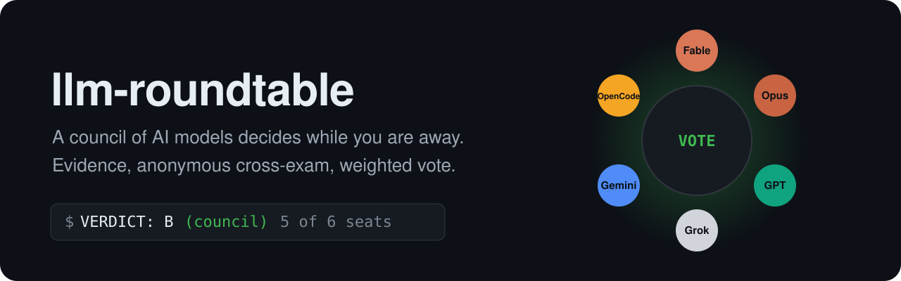
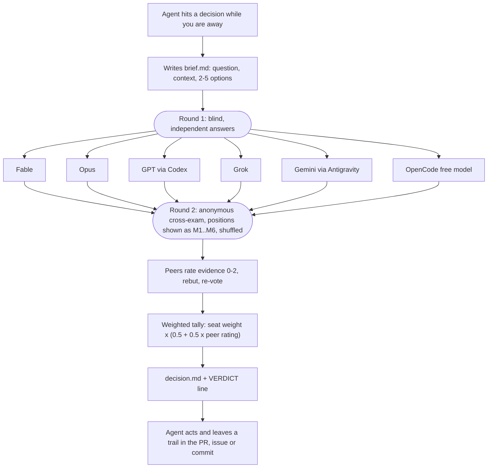

<p align="center">
  
</p>

<h1 align="center">llm-roundtable</h1>

<p align="center">
  <b>A multi-LLM council for autonomous coding agents.</b><br>
  Claude Fable, Claude Opus, GPT (Codex), Grok, Gemini and a free OpenCode model gather evidence,
  cross-examine each other anonymously and cast weighted votes, so your agent keeps working when you are not there to answer.
</p>

<p align="center">
  <a href="https://github.com/dinhkarate/llm-roundtable/actions/workflows/test.yml"></a>
  <a href="https://www.npmjs.com/package/llm-roundtable"></a>
  
  
  <a href="LICENSE"></a>
</p>

<p align="center">
  <a href="#quick-start">Quick start</a> ·
  <a href="#how-it-works">How it works</a> ·
  <a href="#why-not-just-ask-one-model">Why</a> ·
  <a href="#compared-with-other-llm-councils">Comparison</a> ·
  <a href="#faq">FAQ</a> ·
  <a href="README.vi.md">Tiếng Việt</a>
</p>

<p align="center">
  <a href="assets/demo.mp4"></a>
  <br><sub>55-second demo (illustrative run) · <a href="assets/demo.mp4">MP4</a></sub>
</p>

---

**llm-roundtable** is an [Agent Skill](https://github.com/vercel-labs/skills) plus a single Python script.
When an autonomous agent (an overnight `/loop`, a background worker, a CI bot) reaches a point where it would
stop and ask you *"A or B?"*, *"is this plan OK?"* or *"can I merge this diff?"*, it convenes a council of
models from **five different vendors** instead. Each member runs as its own read-only CLI process, cites
evidence, reviews the other members' answers without knowing who wrote them, and votes. The verdict is
computed from the ballots, not written by a "chairman" model, and every run leaves a `decision.md` you can audit later.

- **Uses the subscriptions you already have.** It drives the `claude`, `codex`, `grok`, `agy` (Antigravity) and `opencode` CLIs. No API keys, no proxy, no MCP server.
- **Evidence or it does not count.** A ballot needs at least one sourced `FACT` or `INFERENCE`. Peers rate each other's evidence 0-2, and those ratings scale the vote weight.
- **Anonymous cross-examination.** In round 2 members see every position as M1..Mn, shuffled, in a fresh session, so no member can recognise its own earlier answer or defer to a famous brand.
- **Safe by construction.** Seats are read-only (kernel sandboxes or tool allowlists), outward-publishing tools are removed, credentials are stripped from their environment, and the workspace is fingerprinted before and after the run.
- **Never stalls.** Each seat falls back exactly one model level, then is marked UNATTENDED. A tie goes to the Fable seat, and an undecided council falls back to the safe `--default` you chose.
- **Runs anywhere with a shell.** Claude Code, Codex CLI, Grok CLI, Antigravity, OpenCode, pi. Python 3.9+ standard library only (the version macOS ships).

## Quick start

```bash
# 1. Install the skill for every agent on this machine
npx skills add dinhkarate/llm-roundtable --skill llm-roundtable

# 2. Check which seats can sit (CLI found, logged in, model has quota)
npx llm-roundtable doctor --probe

# 3. Ask a question
cat > brief.md <<'EOF'
# Which database should the billing service use?

Context: 40k writes/day, one region, team of 3, must run on a single VPS.

## Options
- A: PostgreSQL
- B: SQLite with Litestream backups
- C: Defer: keep the JSON files for another month
EOF
npx llm-roundtable run --brief brief.md --default C
```

The last line is always machine-readable:

```text
VERDICT: B (council)
```

Inside an agent you never type these commands yourself. Once the skill is installed, Claude Code, Codex
or any other host reads [`SKILL.md`](skills/llm-roundtable/SKILL.md), writes the brief, runs the council
detached, polls it, and acts on the verdict. Trigger it explicitly with `/llm-roundtable` or *"ask the council"*.

<details>
<summary>Other ways to run it</summary>

```bash
# Without npm: clone and call the script directly (no dependencies)
git clone https://github.com/dinhkarate/llm-roundtable
python3 llm-roundtable/skills/llm-roundtable/scripts/roundtable.py doctor

# Review a plan, PR or diff: options become APPROVE / CHANGES / REJECT
llm-roundtable run --brief plan.md --mode review --workspace .

# Only Claude installed? Fable vs Opus
llm-roundtable run --brief q.md --seats duo

# Cheapest: one blind round
llm-roundtable run --brief q.md --rounds 1

# Progress of a running council
llm-roundtable status
```
</details>

## How it works



1. **Brief.** The host agent writes a self-contained markdown brief with 2-5 concrete options. A secret scanner blocks obvious credentials before anything leaves the machine.
2. **Round 1 (blind).** Every seat answers independently with a vote, confidence, evidence (`FACT` / `INFERENCE` / `ASSUMPTION`, each with a source), risks and conditions.
3. **Round 2 (cross-examination).** Every seat gets the anonymised positions, rates each one's evidence 0-2, writes rebuttals and votes again. Votes may change only when specific evidence forces it, and the change is logged.
4. **Tally.** Each valid ballot counts `seat_weight × (0.5 + 0.5 × mean peer rating)`, so a vote backed by evidence the others rated 2/2 weighs 1.5 and one rated 0/2 weighs 0.5 (self-ratings ignored). Highest score wins. Tie: the option the Fable seat chose, else TIE. Fewer than 2 valid ballots: NO QUORUM. TIE or NO QUORUM: your `--default`.
5. **Act.** The host carries out the verdict including its conditions, and records the question, verdict, strongest evidence, strongest dissent and unattended seats where you will see them.

Full rules, prompts and maths: [`references/protocol.md`](skills/llm-roundtable/references/protocol.md).

### What a run looks like

```text
11:52:43 council: fable, opus, codex, grok, gemini, opencode | options A,B,C,D,E,F | rounds 2
11:52:52 r1 gemini     gemini-3.8-flash-high    quota        8.6s
11:52:55 r1 gemini     gemini-3.7-flash-high    unavailable  3.6s
11:53:35 r1 codex      gpt-6.1-sol              ok          52.2s
11:53:46 r1 opus       claude-opus-5-5          ok          62.8s
11:55:19 r1 fable      claude-fable-5-1         ok         155.7s
11:58:08 r1 grok       grok-4.7                 ok         324.6s
12:00:26 r1 opencode   opencode/cat-jam-free    ok         462.9s
12:01:13 r2 codex      gpt-6.1-sol              ok          47.0s
...
12:05:20 done: verdict D (council)
```

That is a real `progress.log`: Gemini was out of quota and its fallback was not offered, so the seat went
UNATTENDED and the other five decided in 13 minutes. The `decision.md` next to it holds the tally, each
seat's model and weight, who changed their vote and why, the evidence for the winner, the dissent and the
conditions attached to the verdict. See an [example decision.md](docs/example-decision.md).

## Why not just ask one model?

Because the research says the useful part of "multi-agent debate" is mostly the **vote**, and the harmful
part is **models deferring to each other**:

| Finding | What llm-roundtable does about it |
|---|---|
| *Debate or Vote* (Choi, Zhu, Li, NeurIPS 2025): most of the gain from multi-agent debate comes from majority voting; free-form debate alone does not raise expected accuracy. | Round 1 is blind and independent. Only one evidence-bound cross-exam round by default. The verdict is a vote, not a discussion summary. |
| *When Identity Skews Debate* (ACL 2026): models show sycophancy and self-bias when they know who said what; anonymising answers reduces both. | Positions are labelled M1..Mn, shuffled, and every round is a fresh session. Self-ratings are discarded. |
| Homogeneous teams (CAIS 2026): agents from the same model family accept the majority answer up to 85.5% of the time and collapse into consensus. | One seat per model family by default, across five vendors. Single-vendor presets warn you and suggest adding a free OpenCode model. |
| Karpathy's [llm-council](https://github.com/karpathy/llm-council): the models tended to praise GPT and criticise Claude, sometimes against his own judgement. | No chairman model. The verdict is arithmetic on ballots; the host only reports it. |

Details and sources: [`docs/research.md`](docs/research.md).

## Compared with other LLM councils

| | llm-roundtable | [karpathy/llm-council](https://github.com/karpathy/llm-council) | [claude-skills-llm-council](https://github.com/aiwithremy/claude-skills-llm-council) | [council-of-high-intelligence](https://github.com/0xNyk/council-of-high-intelligence) | [Zen / PAL MCP](https://github.com/BeehiveInnovations/zen-mcp-server) `consensus` |
|---|---|---|---|---|---|
| Model access | your CLI subscriptions | OpenRouter API key | Claude only (5 persona subagents) | Claude subagents + codex / gemini / ollama / cursor-agent CLIs, 18 personas | provider API keys |
| Vendors per council | 5 (Anthropic, OpenAI, xAI, Google, OpenCode free) | any via OpenRouter | 1 | Claude + Codex/Gemini/Ollama | any via API |
| Decision | weighted vote, evidence-rated by peers | chairman model synthesises | chairman synthesises | confidence-weighted tally (2/3 to pass), then a chairman writes the verdict | conversation, no vote rule |
| Anonymous peer review | yes, fresh session per round | yes (Response A/B) | yes | yes (relabelled by the coordinator) | no |
| Evidence required to vote | yes, sourced FACT/INFERENCE | no | no | labels, not enforced | no |
| Fallback when a model is down | one level, then UNATTENDED, never blocks | no | n/a | falls back to Claude | no |
| Read-only, sandboxed members | yes, plus workspace tamper check | n/a (web app) | no | no | n/a |
| Undecided council | falls back to your safe `--default` | n/a | n/a | goes back to the user | n/a |
| Runs from | any agent with a shell | browser | Claude Code, Claude Cowork | Claude Code, Codex, Gemini CLI, OpenCode | hosts with MCP |

## Supported hosts and seats

| Seat (default model → fallback) | CLI | Login |
|---|---|---|
| **fable** `claude-fable-5-1` → `claude-fable-5` (breaks ties) | `claude` | Claude subscription |
| **opus** `claude-opus-5-5` → `claude-opus-5` | `claude` | Claude subscription |
| **codex** `gpt-6.1-sol` → `gpt-6-sol` | `codex` | `codex login` (ChatGPT plan) |
| **grok** `grok-4.7` → `grok-4.6` | `grok` | `grok login` |
| **gemini** `gemini-3.8-flash-high` → `gemini-3.7-flash-high` | `agy` (Antigravity) | run `agy` once |
| **opencode** newest free model from a family not already seated | `opencode` | none |

Missing CLIs are not errors; those seats are UNATTENDED and the rest still vote. Presets for one-tool setups:
`duo` (Claude only), `solo-codex`, `solo-grok`, `solo-agy`. Add any other CLI (Qwen, Cursor agent, Aider...)
with a few lines of JSON in `~/.config/roundtable/seats.json`. No code changes: see
[`references/hosts.md`](skills/llm-roundtable/references/hosts.md).

## Safety and privacy

- The brief goes to several vendors. The script refuses briefs that look like they contain secrets, and `--private` drops seats whose provider may train on prompts (OpenCode free models).
- Members are read-only: `claude` with a tool allowlist and no MCP servers, `codex` and `grok` in kernel read-only sandboxes, `agy` sandboxed on a snapshot copy of the workspace.
- Publishing tools (Codex apps, computer use, browser use, MCP servers) are disabled. Unrelated credentials (`GH_TOKEN`, cloud keys...) are stripped from each seat's environment.
- With `--workspace`, the repo is fingerprinted before and after. Any change marks the run TAINTED and `VERDICT: NONE`.
- A seat cannot convene a nested council (`ROUNDTABLE_SEAT` guard).
- The council picks between options the agent was already allowed to take. It never grants permission to push, deploy, delete data or spend money.

## FAQ

**What is an LLM council?**
A group of language models that answer the same question independently and then combine their answers
through review and voting. llm-roundtable is an LLM council built for coding agents: members come from
different vendors, must cite evidence, review each other anonymously, and the decision is a weighted vote.

**Do I need API keys?**
No. It calls the official CLIs you are already logged into (Claude Code, Codex, Grok CLI, Antigravity,
OpenCode), so usage counts against your existing subscriptions. OpenCode free models need no login at all.

**How long does a council take and what does it cost?**
About 12 model calls (6 seats × 2 rounds), typically 5-20 minutes. `--rounds 1` halves it, `--seats duo` uses only two Claude models.

**Can I use it with only Claude Code (or only Codex)?**
Yes. Use the `duo`, `solo-codex`, `solo-grok` or `solo-agy` preset. Adding `opencode` (free, no login) is the
cheapest way to bring in a second vendor, which matters because same-family models tend to agree with each other.

**Can it review a pull request or a plan?**
Yes: `--mode review --workspace .` gives members read-only access to the repo and the options become
APPROVE / CHANGES / REJECT. The project reviews its own changes this way; see the self-review table in
[`docs/research.md`](docs/research.md#4-field-notes).

**Will it change my code?**
No. Members are read-only and the workspace is checked before and after. The host agent acts on the verdict, within the permissions you already gave it.

**What happens when a model is rate-limited?**
The seat retries once on the model one level down in the same family, then is marked UNATTENDED. The council continues as long as at least two valid ballots remain.

**How is this different from karpathy/llm-council?**
llm-council is a web app on OpenRouter where a chairman model writes the final answer. llm-roundtable is an
agent skill that runs headless from your coding agent, uses your CLI subscriptions, and decides by an
evidence-weighted vote instead of a chairman. See the [comparison](#compared-with-other-llm-councils).

## Project layout

```text
skills/llm-roundtable/
  SKILL.md                 instructions the host agent follows
  scripts/roundtable.py    the council (Python 3.9+, stdlib only)
  scripts/seats.json       seats, adapters, presets
  references/protocol.md   rounds, prompts, maths
  references/hosts.md      per-host setup, presets, config overrides
bin/llm-roundtable.js      npm wrapper around the script
docs/research.md           prior art, papers, design notes, field notes
tests/                     unit tests with a fake CLI (no model calls)
```

## Contributing

Issues and pull requests are welcome, especially new seat adapters and CLI quirks. Run
`python3 -m unittest discover -s tests` (no model calls, no quota). See [CONTRIBUTING.md](CONTRIBUTING.md).

If llm-roundtable saved you from a 3 a.m. *"waiting for your input"*, a ⭐ helps other people find it.

## License

[MIT](LICENSE) © dinhkarate
